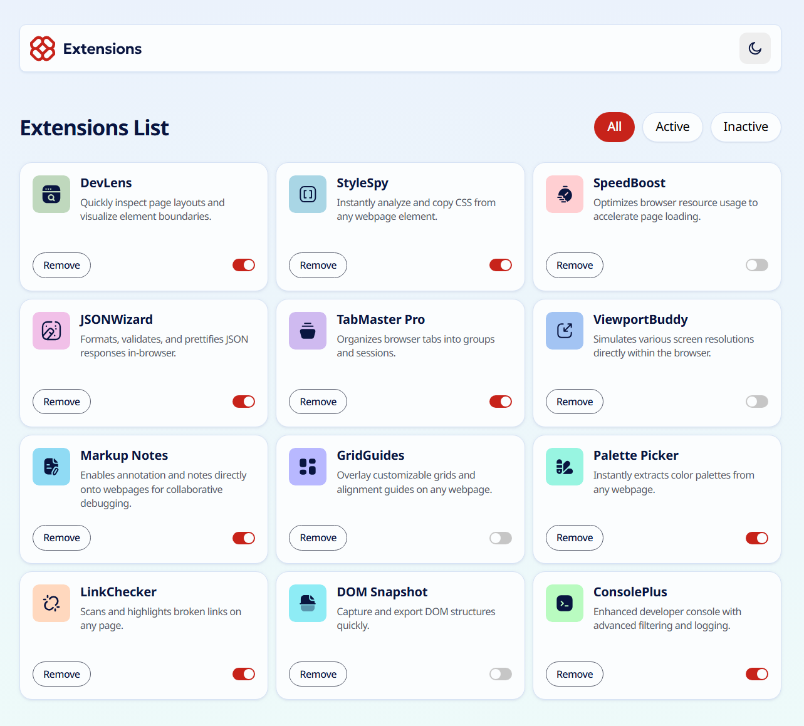
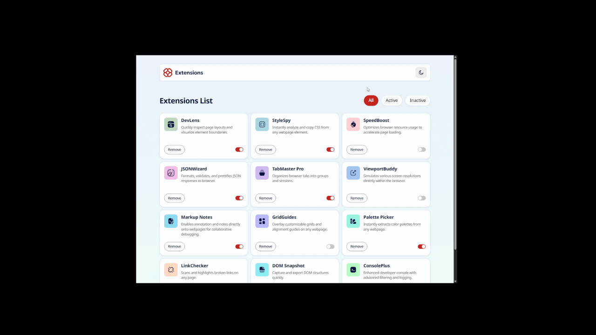
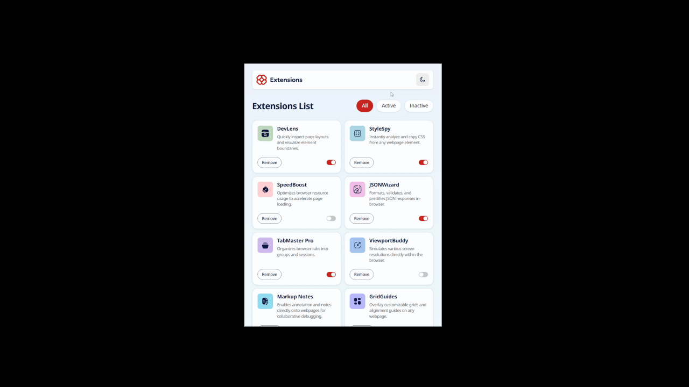
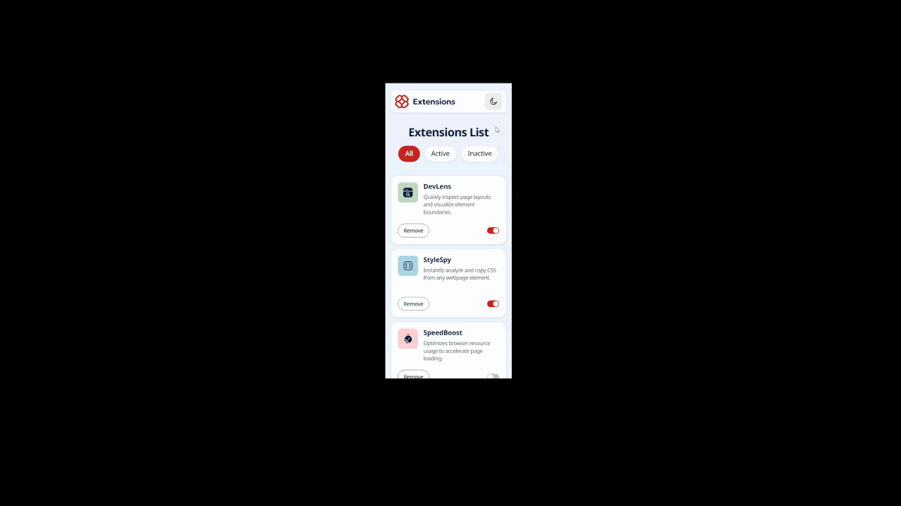

# Frontend Mentor - Browser Extensions Manager UI

A responsive browser extensions manager built as a solution to the [Browser Extensions Manager UI challenge](https://www.frontendmentor.io/challenges/browser-extension-manager-ui-yNZnOfsMAp) on Frontend Mentor.

**[Live Demo](https://quirozdev.github.io/browser-extension-manager-ui/)** · **[Source Code](https://github.com/Quirozdev/browser-extension-manager-ui)**



## Table of Contents

- [Getting Started](#getting-started)
  - [Prerequisites](#prerequisites)
  - [Installation](#installation)
- [Overview](#overview)
  - [Features](#features)
- [Demo](#demo)
- [Built With](#built-with)
- [Author](#author)

## Getting Started

### Prerequisites

- [Node.js](https://nodejs.org/)
- npm

### Installation

**1. Clone the repository**

```bash
git clone https://github.com/Quirozdev/browser-extension-manager-ui.git
cd browser-extension-manager-ui
```

**2. Install dependencies**

```bash
npm install
```

**3. Start the development server**

```bash
npm run dev
```

Open [http://localhost:3000](http://localhost:3000) with your browser to see the application.

## Overview

A browser extensions manager that allows users to manage their installed extensions, filter them by status, and customize the appearance of the interface.

### Features

**Extension Management**

- View all available extensions in a responsive card layout.
- Toggle extensions between active and inactive states.
- Remove extensions from the list.
- Filter extensions by all, active, or inactive status.
- Smooth exit animations when removing extensions.

**Theme**

- Switch between light and dark themes.
- Maintain consistent colors and styles across both themes.

**Responsive Design & Accessibility**

- Responsive layouts for desktop, tablet, and mobile devices.
- Hover and focus states for interactive elements.
- Accessible controls and interaction states.

## Demo

### Desktop



### Tablet



### Mobile



## Built With

- [React](https://react.dev/)
- [TypeScript](https://www.typescriptlang.org/)
- [Tailwind CSS](https://tailwindcss.com/)
- [Framer Motion](https://motion.dev/)

**Development Practices**

- Feature-based project organization.
- Component-based architecture.
- CSS custom properties for theme management.
- Mobile-first development workflow.

## Author

- GitHub - [@Quirozdev](https://github.com/Quirozdev)
